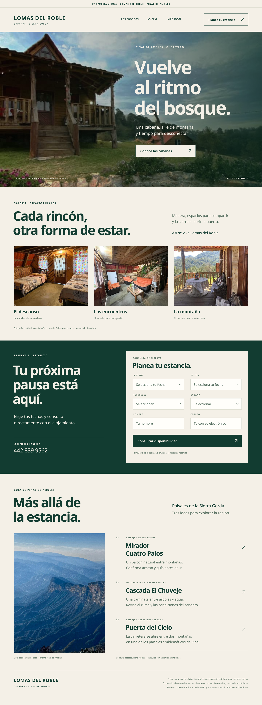

# Cabañas Lomas del Roble · Pinal de Amoles

Propuesta visual independiente, no oficial y no aprobada por el alojamiento. Preparada el 6 de noviembre de 2026, siguiendo la dirección visual de Casa Musgo v2.

- [Ver imagen completa](imagenes/landing-concepto-v1.png)
- [Consultar ficha y enlaces comerciales](ficha.md)
- [Consultar alcance, fotografías y fuentes](propuesta.md)

## Qué incluye

Hero con fotografía real de la cabaña, galería auténtica, formulario conceptual de consulta y guía de Pinal de Amoles. No se generaron instalaciones con IA, no se inventó un logotipo y no hay reservas activas.

**Selección:** no se localizó un sitio web propio en la revisión de Google Maps, Facebook y búsqueda web. Maps dirige a Facebook. Airbnb es un canal de terceros, no un dominio propio identificado. Esto no prueba que una web no exista.

**Para Muse:** verificar el historial de contacto fuera del repositorio antes de cualquier envío, confirmar destinatario y revisar derechos de fotografías y marca. Si el historial no está disponible, dejar el envío pendiente. No se contactó al alojamiento durante esta preparación. Publicar aquí no equivale a haber enviado la propuesta.
