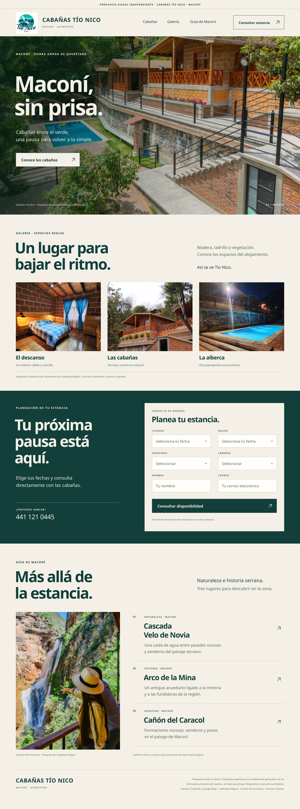

# Cabañas Tío Nico · Maconí, Querétaro

Propuesta visual independiente con fotografías auténticas y el logotipo del alojamiento. No es el sitio oficial ni está aprobada por el establecimiento.

- [Ver imagen completa](imagenes/landing-concepto-v1.png)
- [Ficha comercial y verificación](ficha.md)
- [Alcance del diseño](propuesta.md)
- [Fuentes de fotografías y turismo](fuentes.md)

**Estado:** preparada para revisión de Muse. No enviada al hotel. Antes de cualquier envío, revisar el historial de contacto fuera de este repositorio, evitar duplicados, verificar al destinatario y validar derechos de uso. Si el historial no está disponible, el envío queda pendiente.

Se revisaron Google Maps, Facebook y búsquedas web el 6 de noviembre de 2026. No se localizó un sitio propio en las fuentes consultadas; esto no prueba su inexistencia absoluta. La ficha pública del directorio Cadereyta Mágico y las redes sociales no se presentan como un dominio propio del alojamiento.
