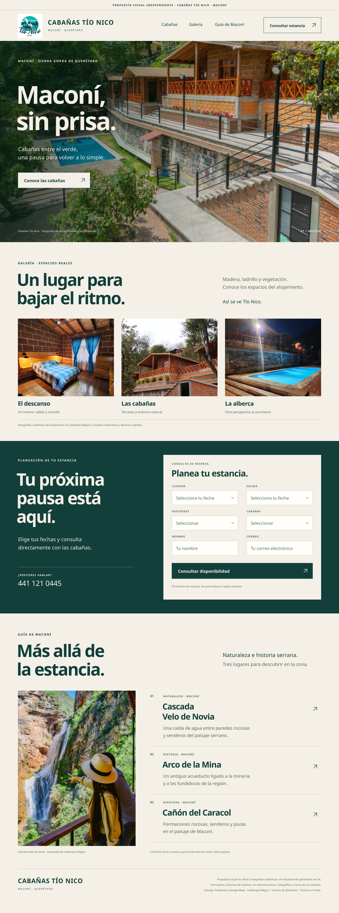

# Cabañas Tío Nico · propuesta visual v1

Preparada el 6 de noviembre de 2026. Concepto independiente, no oficial y no aprobado por el alojamiento.

## Diseño

Una imagen de **1440 × 3880 px**, siguiendo la dirección editorial de Casa Musgo v2: fondo marfil, verde profundo, tipografía sans serif, fotografía panorámica y amplios espacios.

1. Encabezado con logotipo auténtico, corroborado entre Facebook y Cadereyta Mágico.
2. Hero con foto real de las cabañas y alberca, tomada de su portada pública de Facebook.
3. Galería con habitación, exterior y alberca nocturna, procedentes de la ficha específica del alojamiento en Cadereyta Mágico.
4. Formulario conceptual con llegada, salida, huéspedes, cabañas, nombre y correo. Incluye aviso de que no envía datos ni realiza reservas. El número comercial publicado es 441 121 0445.
5. Guía de Maconí con Cascada Velo de Novia, Arco de la Mina y Cañón del Caracol, con fuentes enlazadas en [fuentes.md](fuentes.md). La foto turística se distingue de las instalaciones del alojamiento.

## Límites

Es una maqueta estática: no incluye una web funcional, dominio, alojamiento, sistema de pago ni motor de reservas. No publica tarifas, disponibilidad, capacidades, beneficios incluidos ni políticas no verificadas. No presenta reseñas inventadas.

No se generaron habitaciones, instalaciones o paisajes con IA. Solo se compusieron fotografías auténticas con tipografía, encuadres y una capa de contraste en el hero. No se sustituyó el logotipo por uno inventado.

Las fotos y la marca pertenecen a sus titulares. Su presencia pública no demuestra licencia abierta ni permiso del establecimiento para uso comercial. Confirmar derechos y aprobación antes de implementar o distribuir comercialmente. La publicación de este concepto no otorga derechos sobre los activos.

## Para Muse

Revisar el historial antes de enviar. Confirmar destinatario y posibles envíos anteriores. Si no existe acceso al historial, el envío queda pendiente. No presentar el diseño como sitio oficial, activo o aprobado por Tío Nico. No se ha contactado al alojamiento durante la preparación.
