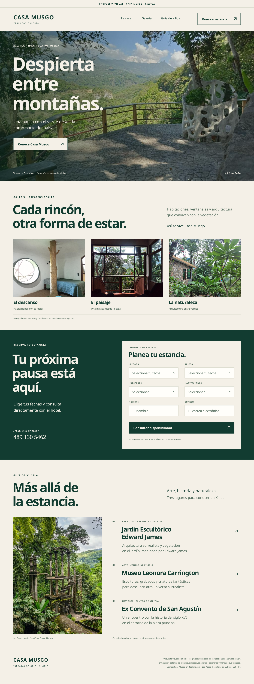

# Casa Musgo · propuesta visual web v2 aprobada

**Versión vigente aprobada por el solicitante para publicar en este repositorio.** Concepto independiente, no oficial y no aprobado por Casa Musgo. La aprobación de la propuesta no acredita un envío al hotel.

Preparada y revisada el 6 de noviembre de 2026.

[Ver imagen completa v2](imagenes/landing-concepto-v2.png) · [Ficha comercial](ficha.md) · [Versión anterior v1](propuesta.md)

## Diseño y alcance

Una sola imagen de 1440 × 3880 px, con estética editorial en marfil y verde profundo y jerarquía de tipografía sans serif grande y pequeña.

1. **Hero:** fotografía panorámica auténtica de la terraza de Casa Musgo, con las montañas al fondo.
2. **Galería:** tres fotografías reales de una habitación, un ventanal y el exterior del hotel.
3. **Reserva:** formulario visual con llegada, salida, huéspedes, habitaciones, nombre y correo. Es de muestra; no envía datos ni realiza reservas.
4. **Guía turística final:** Las Pozas, Museo Leonora Carrington y Ex Convento de San Agustín, todos en Xilitla.

No incluye código funcional, alojamiento, dominio, motor de reservas, tarifas ni disponibilidad. Los controles son elementos de la maqueta. No se contactó al hotel durante su preparación.

## Fotografías usadas

Las cuatro fotografías del hotel se descargaron desde el visor de su [ficha pública en Booking.com](https://www.booking.com/hotel/mx/casa-musgo.es-mx.html), después de verificar nombre, dirección y galería. Los originales usados tienen 1024 × 768 px y se inspeccionaron visualmente.

- **Hero, terraza:** [fotografía 575922403](https://cf.bstatic.com/xdata/images/hotel/max1024x768/575922403.jpg?k=3452353164d128e4237253af34cd300c4e34710a012ad8b29fca9b5df2c8bf43&o=).
- **Galería, habitación con ventana circular:** [fotografía 791110091](https://cf.bstatic.com/xdata/images/hotel/max1024x768/791110091.jpg?k=acfdcc16b2a8cbc5ce035648592acf3d5bd219216f7a8b449e859d465d3f4fd7&o=).
- **Galería, ventanal abierto:** [fotografía 502779845](https://cf.bstatic.com/xdata/images/hotel/max1024x768/502779845.jpg?k=36c4b8f389c92cac690a0bbbcb1495e582a476490ac3d6c3fb2e8755a8c24e14&o=).
- **Galería, exterior de piedra entre vegetación:** [fotografía 502779827](https://cf.bstatic.com/xdata/images/hotel/max1024x768/502779827.jpg?k=a3891227f06cb86dcedc142576a6d2860ccf9c33173e1ab259ee62ac664b9e3a&o=).
- **Guía, Las Pozas:** [fotografía del sitio oficial del Jardín Escultórico Edward James](https://laspozasxilitla.org.mx/wp-content/uploads/2022/04/Edward-James_Xilitla_High-74-1-1-2-1.jpg), 500 × 660 px. Crédito de procedencia: Jardín Escultórico Edward James, Las Pozas / Fundación Pedro y Elena Hernández A.C. No se encontró atribución individual del fotógrafo.

No se generaron habitaciones, paisajes o instalaciones con IA. No se usó el montaje de Facebook de v1. Los encuadres y la capa de contraste del hero son recursos de composición de la maqueta. El encabezado presenta el nombre como texto, no un logotipo inventado.

Las fotografías y la marca pertenecen a sus respectivos titulares. Su disponibilidad pública no acredita una licencia abierta ni autorización del hotel para una web comercial. Confirmar los derechos de uso y la aprobación del establecimiento antes de implementar o distribuir comercialmente. Esta propuesta no otorga una licencia sobre los activos.

## Guía turística y fuentes

- **Jardín Escultórico Edward James, Las Pozas:** Camino Paseo Las Pozas s/n, Barrio La Conchita, Xilitla. [Sitio oficial](https://laspozasxilitla.org.mx/).
- **Museo Leonora Carrington Xilitla:** Corregidora 103, Centro. [Secretaría de Cultura](https://sic.cultura.gob.mx/ficha.php?table=museo&table_id=2004).
- **Ex Convento de San Agustín:** centro de Xilitla, entorno de la plaza principal. [SECTUR](https://www.gob.mx/sectur/articulos/xilitla-san-luis-potosi) y [mapa turístico de la Huasteca, Turismo SLP](https://turismoslp.com.mx/Principal/Descargas/Mapa_Huasteca.pdf).

La relación del hotel con Xilitla, su centro y Las Pozas también se documenta en este [reportaje de Página Zero](https://www.paginazero.com.mx/descubre-este-proyecto-de-hospedaje-surreal-en-xilitla). La guía no publica kilómetros, minutos, precios ni horarios sin comprobar rutas y vigencia.

## Indicaciones para Muse

- Usar **v2** como versión vigente; no confundirla con v1, que se conserva.
- Revisar historial de contacto y envíos anteriores fuera del repositorio; si no está disponible, dejar el envío pendiente.
- Confirmar destinatario, datos comerciales y derechos de uso.
- No presentar esta maqueta como web publicada, sistema de reservas activo ni diseño aprobado por el hotel.
- La publicación en GitHub no equivale a haber enviado la propuesta ni configura automatizaciones.
